<picture>
  <source media="(prefers-color-scheme: dark)" srcset="assets/umap-dark.svg">
  
</picture>

### Harry Nguyen

Computational biology · Case Western Reserve University

I build interpretable machine learning for biology: models whose internals map
onto pathways, cell types, and clinical mechanism, so every prediction comes
with a reason.

**Packages**

- [**VNNBio**](https://github.com/mxn581-dev/VNNBio) · R  
  Visible neural networks constrained by pathway topology, with DAG-decomposed
  Shapley attribution. S4 architecture, Julia backend via Lux.jl.
- [**oncoPATHr**](https://github.com/mxn581-dev/oncoPATHr) · R  
  Converts somatic mutation data (MAF) into pathway-level treatment resistance
  profiles for precision oncology.

**Research**

- Kidney single-cell transcriptomics, Gonzalez-Vicente Lab, CWRU (KPMP)
- Sepsis organ dysfunction and corticosteroid treatment heterogeneity, Broad Institute

**Presentations**

- ASN Kidney Week 2026: DDX41 poster
- ABRCMS 2026

R · Python · Julia · Lux.jl · PyTorch · Seurat · scanpy · causal inference

[mxn581@case.edu](mailto:mxn581@case.edu)
