<picture>
  <source media="(prefers-color-scheme: dark)" srcset="assets/umap-dark.svg">
  
</picture>
### Harry Nguyen

Mathematical ML · Low-Energy Edge AI · Dynamical Systems  
Case Western Reserve University

I build ultra-compact, uncertainty-calibrated predictive models and causal world models for irregular dynamical systems—bridging continuous-time physiological modeling, conformal guarantees, and sub-milliwatt microcontroller deployment.

Compression usually gets reported as one number: in-distribution accuracy. I care about the rest. Does a quantized model still transfer across hospitals, labs, and hardware targets, and what breaks first when it doesn't?

**Systems & Software**

- [**MicroTwin**](https://github.com/nguyenha-ops) · Python, C/C++, CMSIS-NN  
  On-device clinical digital twin using quantization-aware training (10K–100K INT8 parameters), online conformal quantile tracking, and doubly robust counterfactual distillation for Arm Cortex-M55 + Ethos-U85.
- [**Edge LLM Compression (Gemma 3 270M)**](https://github.com/nguyenha-ops) · PyTorch, Arm Vela, ExecuTorch  
  Compressed the 262K-token vocabulary output head to 16K for offline NPU deployment on Arm Cortex-M55 + Ethos-U85.
- [**TinyCell**](https://github.com/nguyenha-ops) · Python, NumPy  
  INT8/INT4 quantized inference engine achieving 99.3–99.99% FP32 agreement in zero-shot cross-lab transfer; uncovered a `float32` underflow threshold disabling L2 regularization in scikit-learn's SAG solver.
- [**VNNBio**](https://github.com/mxn581-dev/VNNBio) · R, Julia (`Lux.jl`)  
  DAG-constrained visible neural networks encoding structured priors for interpretable attribution and axiomatic Shapley decomposition.

**Research**

- **Broad Institute of MIT and Harvard (Schmidt Center):** Causal target trial emulation and `PRISM`, a 72-model cascaded LightGBM framework for multi-horizon ICU organ-dysfunction forecasting ($n = 334,000$ trajectories), exported to offline ONNX.
- **CWRU Department of ECSE (Datta Lab):** Sub-milliwatt neural architectures, post-training quantization, and edge NPU/MCU compilation.
- **NIH / NHLBI (Incoming Summer 2027):** Predictive modeling and dynamical systems for ICU electrolyte homeostasis and hyponatremia.

**Selected Presentations**

- **Broad Institute Symposium (2026):** *PRISM: Personalized Risk-Integrated Sepsis Monitor*
- **ABRCMS (2026):** Best Poster Presentation Award — Multi-Horizon Organ-Specific Forecasting
- **CWRU Intersections (2026):** *VNNBio: Axiomatically Fair Pathway Attribution via Visible Neural Networks*

Python · C/C++ · CUDA · Julia · R · PyTorch · Lux.jl · ONNX · ExecuTorch · CMSIS-NN · Arm Vela

[mxn581@case.edu](mailto:mxn581@case.edu) · [ORCID](https://orcid.org/0009-0009-6206-6121)
